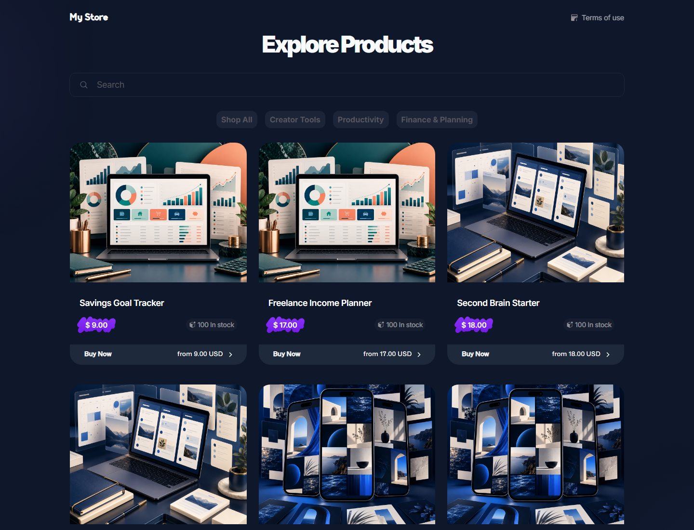
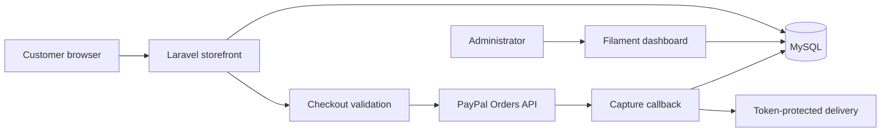
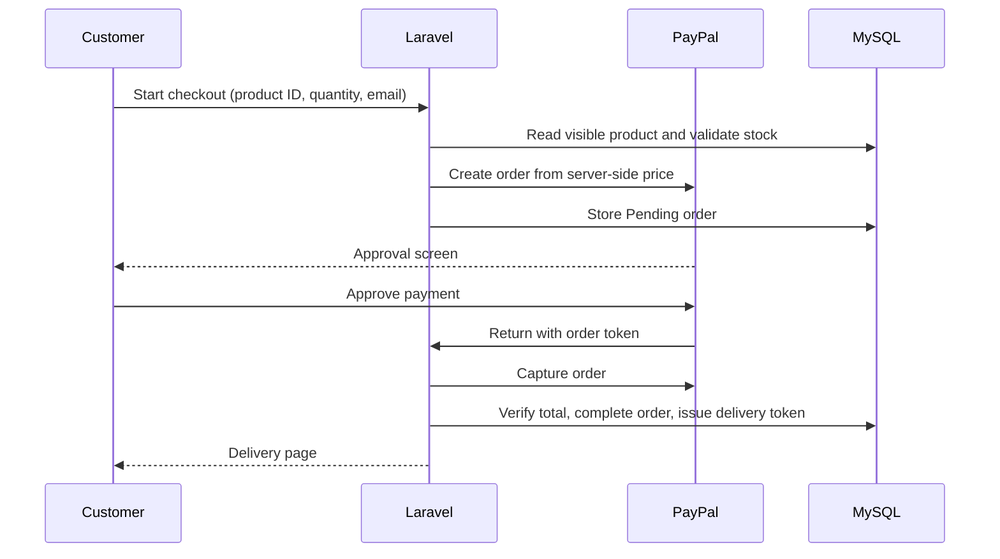

# Digital Products Store

Laravel storefront for downloadable digital products, with a responsive public catalog, PayPal checkout, protected delivery links, and a Filament admin dashboard.

**Live demo:** [digital-products-store-smoky.vercel.app](https://digital-products-store-smoky.vercel.app/)

<p align="center">
  
</p>

## Features

- Visible-product catalog with pagination, search, categories, and mobile-friendly horizontal category scrolling.
- Product and checkout pages that validate visibility, stock, and quantity on the server.
- PayPal Orders flow that calculates product name and pricing from the database, never browser-submitted prices.
- Customer and order records with Pending, Completed, and Declined states.
- Random delivery tokens available only for completed orders.
- Filament dashboard for products, categories, customers, orders, settings, colors, and Terms of Use.
- Fresh-database seeders for the demo palette, three categories, and nine example products.

## Architecture



### Checkout lifecycle



## Stack

| Area | Technology |
| --- | --- |
| Application | Laravel 10, PHP 8.1+ |
| Admin | Filament 3 |
| Database | MySQL / MariaDB |
| Payments | PayPal via `srmklive/paypal` |
| Frontend | Blade, CSS, Vite, Tailwind utilities |
| Production | FrankenPHP on PHP 8.3, Vercel Container Runtime |

## Repository layout

```text
app/Filament/              Dashboard pages and resources
app/Http/Controllers/      Catalog, checkout, and PayPal flows
database/migrations/       Database schema
database/seeders/          Settings and demo-catalog seeders
public/frontend1/          Storefront assets and styles
public/storage/form-attachments/  Demo cover images
resources/views/           Blade storefront, checkout, and mail views
routes/web.php             Public routes
Dockerfile.vercel          Production image
vercel.json                Vercel container configuration
```

## Local development

### Prerequisites

- PHP 8.1+ with `pdo_mysql`
- Composer 2
- Node.js 20+ and npm
- MySQL 8+ or MariaDB 10.6+

### Install

```bash
git clone https://github.com/b4d5hub/Digital_Products_Store.git
cd Digital_Products_Store

composer install
npm ci
cp .env.example .env
php artisan key:generate
```

On Windows PowerShell, use `Copy-Item .env.example .env` instead of `cp`.

Configure MySQL in `.env`, then create the schema and demo catalog:

```bash
php artisan migrate --seed
npm run build
php artisan serve
```

Use `npm run dev` in a second terminal for frontend development.

## Fresh-install demo data

`DatabaseSeeder` runs:

| Seeder | Purpose |
| --- | --- |
| `StoreSettingsSeeder` | Creates USD store variables and the slate UI palette. |
| `DemoCatalogSeeder` | Creates the demo catalog only when products and categories are both empty. |

The catalog contains **Creator Tools**, **Productivity**, and **Finance & Planning**, with nine visible, in-stock downloadable products and bundled cover images. It will not replace a catalog that already contains products or categories.

Demo downloads use a public placeholder URL. Replace every product's **Digital item** with a real delivery destination before accepting sales.

## Environment configuration

Start from `.env.example`. Never commit a real `.env` file or credentials.

### Application and database

```dotenv
APP_NAME="Digital Products Store"
APP_ENV=production
APP_KEY=base64:replace-with-a-generated-key
APP_DEBUG=false
APP_URL=https://your-domain.example

DB_CONNECTION=mysql
DB_HOST=your-database-host
DB_PORT=3306
DB_DATABASE=your_database
DB_USERNAME=your_database_user
DB_PASSWORD=use-a-strong-secret

SESSION_DRIVER=database
SESSION_LIFETIME=120
```

Database-backed sessions are important for horizontally scaled or container deployments. The migration set includes the required `sessions` table.

### PayPal Sandbox

```dotenv
PAYPAL_MODE=sandbox
PAYPAL_SANDBOX_CLIENT_ID=your-sandbox-client-id
PAYPAL_SANDBOX_CLIENT_SECRET=your-sandbox-client-secret
PAYPAL_CURRENCY=USD
```

Use the `PAYPAL_LIVE_*` variables only after completing PayPal live-app setup.

### Mail

The production Docker image defaults to `MAIL_MAILER=log`, which is suitable for demos but does **not** deliver email. Configure SMTP or a transactional provider before launch:

```dotenv
MAIL_MAILER=smtp
MAIL_HOST=smtp.example.com
MAIL_PORT=587
MAIL_USERNAME=your-username
MAIL_PASSWORD=your-password
MAIL_ENCRYPTION=tls
MAIL_FROM_ADDRESS=orders@your-domain.example
MAIL_FROM_NAME="${APP_NAME}"
```

## Admin dashboard

The Filament panel is available at `/dashboard`. It manages products, categories, customers, orders, and Store Settings. Store Settings controls the name, currency, colors, and public Terms of Use content.

Dashboard access is controlled by `User::canAccessPanel()`. The demo uses a single configured email address; replace this with role- or permission-based authorization before giving access to multiple people.

## Vercel deployment

The app runs in Vercel's Container Runtime using `Dockerfile.vercel` and `vercel.json`.

1. Import the GitHub repository into Vercel.
2. Add application, database, session, PayPal, and mail variables in **Project Settings → Environment Variables**.
3. Ensure the database accepts connections from the deployed container.
4. From a trusted environment that can reach the database, run:

   ```bash
   php artisan migrate --seed --force
   ```

5. Deploy `main`, then check `/health` returns:

   ```json
   {"status":"ok"}
   ```

### Vercel considerations

- Container filesystems are ephemeral: do not use local uploads as durable paid-download storage.
- Use protected object storage or another durable service for real digital files.
- A deployment does not replace safe, deliberate database migrations.

## Routes

| Route | Purpose |
| --- | --- |
| `/` | Product catalog |
| `/product/{slug}` | Product details |
| `/collection/{slug}` | Category catalog |
| `/checkout/{slug}` | Quantity-aware checkout |
| `POST /paypal` | Starts a PayPal order |
| `/success` and `/cancel` | PayPal return routes |
| `/terms` | Editable public Terms of Use page |
| `/health` | Health check |

## Quality checks

```bash
php artisan test
./vendor/bin/pint --test
./vendor/bin/pint
```

## Production checklist

- [ ] Set `APP_ENV=production` and `APP_DEBUG=false`.
- [ ] Keep MySQL private and firewall-restricted.
- [ ] Replace demo product files, copy, prices, and Terms content.
- [ ] Configure real transactional mail.
- [ ] Configure PayPal live credentials only when ready to sell.
- [ ] Add PayPal webhooks and order reconciliation before accepting real payments at scale.
- [ ] Replace the single-email dashboard rule with roles or permissions.
- [ ] Store paid digital files in durable protected storage.
- [ ] Maintain database backups, monitoring, and alerting.

## Security notes

- Never commit API keys, database passwords, or `.env` files.
- Checkout pricing, visibility, and stock are loaded from the database rather than trusted from the browser.
- Downloads require a random token and a completed order.

## License

No license file is currently included. Add a `LICENSE` file before public distribution or external contributions.

<!-- Legacy Laravel scaffold retained below only for repository history; it is intentionally hidden from the rendered README.

<p align="center"><a href="https://laravel.com" target="_blank"></a></p>

<p align="center">
<a href="https://github.com/laravel/framework/actions"></a>
<a href="https://packagist.org/packages/laravel/framework"></a>
<a href="https://packagist.org/packages/laravel/framework"></a>
<a href="https://packagist.org/packages/laravel/framework"></a>
</p>

## About Laravel

Laravel is a web application framework with expressive, elegant syntax. We believe development must be an enjoyable and creative experience to be truly fulfilling. Laravel takes the pain out of development by easing common tasks used in many web projects, such as:

- [Simple, fast routing engine](https://laravel.com/docs/routing).
- [Powerful dependency injection container](https://laravel.com/docs/container).
- Multiple back-ends for [session](https://laravel.com/docs/session) and [cache](https://laravel.com/docs/cache) storage.
- Expressive, intuitive [database ORM](https://laravel.com/docs/eloquent).
- Database agnostic [schema migrations](https://laravel.com/docs/migrations).
- [Robust background job processing](https://laravel.com/docs/queues).
- [Real-time event broadcasting](https://laravel.com/docs/broadcasting).

Laravel is accessible, powerful, and provides tools required for large, robust applications.

## Learning Laravel

Laravel has the most extensive and thorough [documentation](https://laravel.com/docs) and video tutorial library of all modern web application frameworks, making it a breeze to get started with the framework.

You may also try the [Laravel Bootcamp](https://bootcamp.laravel.com), where you will be guided through building a modern Laravel application from scratch.

If you don't feel like reading, [Laracasts](https://laracasts.com) can help. Laracasts contains thousands of video tutorials on a range of topics including Laravel, modern PHP, unit testing, and JavaScript. Boost your skills by digging into our comprehensive video library.

## Laravel Sponsors

We would like to extend our thanks to the following sponsors for funding Laravel development. If you are interested in becoming a sponsor, please visit the [Laravel Partners program](https://partners.laravel.com).

### Premium Partners

- **[Vehikl](https://vehikl.com/)**
- **[Tighten Co.](https://tighten.co)**
- **[WebReinvent](https://webreinvent.com/)**
- **[Kirschbaum Development Group](https://kirschbaumdevelopment.com)**
- **[64 Robots](https://64robots.com)**
- **[Curotec](https://www.curotec.com/services/technologies/laravel/)**
- **[Cyber-Duck](https://cyber-duck.co.uk)**
- **[DevSquad](https://devsquad.com/hire-laravel-developers)**
- **[Jump24](https://jump24.co.uk)**
- **[Redberry](https://redberry.international/laravel/)**
- **[Active Logic](https://activelogic.com)**
- **[byte5](https://byte5.de)**
- **[OP.GG](https://op.gg)**

## Contributing

Thank you for considering contributing to the Laravel framework! The contribution guide can be found in the [Laravel documentation](https://laravel.com/docs/contributions).

## Code of Conduct

In order to ensure that the Laravel community is welcoming to all, please review and abide by the [Code of Conduct](https://laravel.com/docs/contributions#code-of-conduct).

## Security Vulnerabilities

If you discover a security vulnerability within Laravel, please send an e-mail to Taylor Otwell via [taylor@laravel.com](mailto:taylor@laravel.com). All security vulnerabilities will be promptly addressed.

## License

The Laravel framework is open-sourced software licensed under the [MIT license](https://opensource.org/licenses/MIT).
-->
